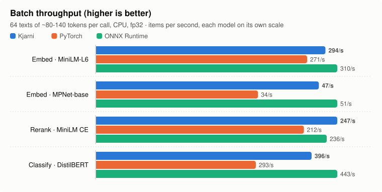
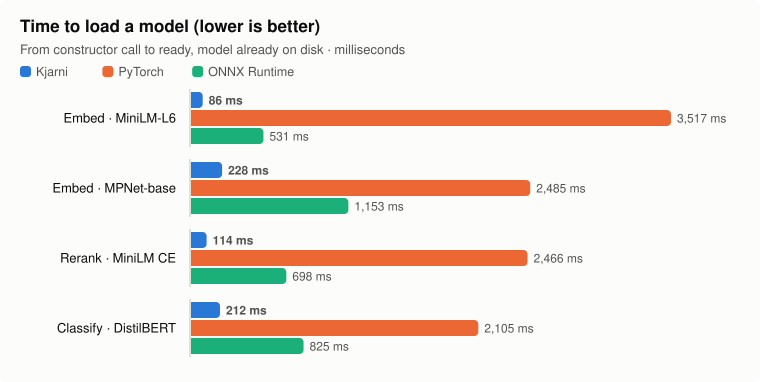
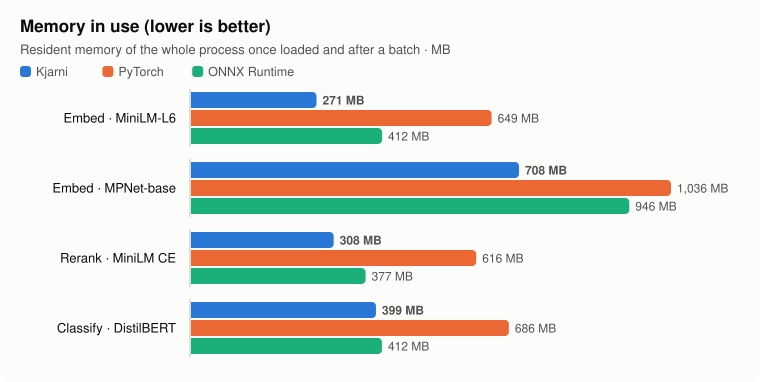

# Kjarni

[](https://www.nuget.org/packages/Kjarni)
[](https://pypi.org/project/kjarni/)
[](https://crates.io/crates/kjarni)
[](https://pkg.go.dev/github.com/olafurjohannsson/kjarni-go)
[](https://github.com/olafurjohannsson/kjarni/actions/workflows/ci.yml)
[](#license)

**Local embeddings, semantic search, classification, reranking, chat, speech to text, summarization, translation and image search for C#, Go, Rust, Python, C++ and the command line.**

Kjarni is a native inference engine written from scratch in Rust. It ships as a single shared library, downloads its own models, and runs entirely on your machine.

## Try it in 30 seconds

**Nothing to install:** the [browser demo](https://kjarni.ai/demo) runs the engine in your own tab.

**Or one command, and it works:**

```bash
curl -fsSL https://kjarni.ai/install.sh | sh    # Windows: irm https://kjarni.ai/install.ps1 | iex
```

```console
$ kjarni classify "This is wonderful"
  ✓       POSITIVE  ████████████████████  100.0%
          NEGATIVE  ░░░░░░░░░░░░░░░░░░░░    0.0%

$ kjarni similarity "doctor" "physician"
  █████████████████░░░   86.0%  highly similar

$ echo "Great service" | kjarni classify --format json | jq -r '.label'
POSITIVE
```

The model downloads on first use and is cached. Everything after that works offline.

**In your own code**, it is the same three lines in every language:

```csharp
using var embedder = new Embedder("minilm-l6-v2");
Console.WriteLine(embedder.Similarity("doctor", "physician"));   // 0.8598
```

```bash
dotnet add package Kjarni                             # C# / .NET
go get github.com/olafurjohannsson/kjarni-go@latest   # Go
```

[Every language below](#install), including C++ and the browser.

<sub>The name is Icelandic [ˈkʰjartnɪ]. It means "core."</sub>

**[Install](#install)** · **[Examples](#the-same-thing-in-every-language)** · **[Browser demo](https://kjarni.ai/demo)** · **[Why it exists](#why-kjarni-exists)** · **[How it compares](#how-it-compares)**

---

## Install

**C# / .NET** — [nuget.org/packages/Kjarni](https://www.nuget.org/packages/Kjarni)

```bash
dotnet add package Kjarni
```

**Go** — [pkg.go.dev/github.com/olafurjohannsson/kjarni-go](https://pkg.go.dev/github.com/olafurjohannsson/kjarni-go)

```bash
go get github.com/olafurjohannsson/kjarni-go@latest
```

**CLI**

```bash
curl -fsSL https://kjarni.ai/install.sh | sh    # Linux / macOS
irm https://kjarni.ai/install.ps1 | iex         # Windows
```

**Python**

```bash
pip install kjarni          # no dependencies at all
pip install kjarni[numpy]   # adds ndarray returns from encode_batch
```

The plain install pulls nothing: no PyTorch, no ONNX Runtime, no numpy. The native
library ships inside the wheel and the vectors match `sentence-transformers` to four
decimal places.

**Rust**

```bash
cargo add kjarni
```

**C++** — no package manager. Four commands from nothing to output:

```bash
mkdir kjarni-quickstart && cd kjarni-quickstart
curl -sL https://github.com/olafurjohannsson/kjarni/releases/latest/download/kjarni-x86_64-linux.tar.gz | tar xz
curl -sO https://raw.githubusercontent.com/olafurjohannsson/kjarni/main/crates/kjarni-ffi/examples/cpp/hello.cpp
g++ -std=c++23 hello.cpp -I. -L. -lkjarni_ffi -Wl,-rpath,'$ORIGIN' -o hello && ./hello
```

```
related:   0.5510
unrelated: -0.0630
```

The archive holds the shared library, `kjarni.h` (the C ABI) and `kjarni.hpp` (a
header-only C++23 wrapper with RAII handles and `std::expected` errors). macOS and
Windows builds are on the same [releases](https://github.com/olafurjohannsson/kjarni/releases)
page; see [the C++ guide](crates/kjarni-ffi/examples/cpp/README.md) for those and for
classification, reranking and chat.

Only `kjarni.hpp` needs C++23, and only for `std::expected`. `kjarni.h` is plain C and
works from C++11 upward, which is what every other binding here is built on;
[`hello_c_api.cpp`](crates/kjarni-ffi/examples/cpp/hello_c_api.cpp) is the same program
written that way.

**Browser (WebAssembly)** — [npmjs.com/package/kjarni-wasm](https://www.npmjs.com/package/kjarni-wasm)

```bash
npm i kjarni-wasm
```

Or without a bundler, straight from a CDN:

```html
<script type="module">
  import { Kjarni } from "https://cdn.jsdelivr.net/npm/kjarni-wasm/dist/index.js";
</script>
```

Nothing installed at all: one file that downloads a model and ranks sentences by
meaning in your browser.

```bash
curl -sO https://raw.githubusercontent.com/olafurjohannsson/kjarni/main/crates/kjarni-wasm/examples/quickstart.html
python3 -m http.server 8000    # then open http://localhost:8000/quickstart.html
```

It imports the wasm module straight from a CDN and runs on the page, no Worker and
no build step. See [the browser examples](crates/kjarni-wasm/examples) for search,
classification and chat, and [the package guide](crates/kjarni-wasm/ts/README.md)
for the `Kjarni` wrapper that moves inference off the main thread.

The package runs inference in a Web Worker, so loading a model or generating a reply never freezes the page. The raw wasm-bindgen bundle is also in `kjarni-wasm.tar.gz` on [releases](https://github.com/olafurjohannsson/kjarni/releases) if you would rather drive it yourself.

Models for the browser are packed as `.kjq`, a single file holding config, tokenizer and int8 weights. See [the format guide](crates/kjarni-wasm/scripts/README.md) for how to make your own.

Models download on first use and are cached in `~/.cache/kjarni` (`%LOCALAPPDATA%\kjarni` on Windows). No configuration required.

## The same thing in every language

Semantic similarity, the smallest useful program, in each binding.

**C#**

```csharp
using var embedder = new Embedder("minilm-l6-v2");
Console.WriteLine(embedder.Similarity("doctor", "physician"));   // 0.8598
```

**C++**

```cpp
#include "kjarni.hpp"

auto embedder = kjarni::Embedder::create({.model = "minilm-l6-v2"});
auto a = embedder->encode("doctor");
auto b = embedder->encode("physician");
std::println("{:.4f}", kjarni::cosine(*a, *b));                  // 0.8598
```

**Go**

```go
e, _ := kjarni.NewEmbedder("minilm-l6-v2")
defer e.Close()
sim, _ := e.Similarity("doctor", "physician")
fmt.Println(sim)                                                 // 0.8598
```

**Python**

```python
from kjarni import Classifier

classifier = Classifier("distilbert-sentiment")
print(classifier.classify("i love kjarni").label)                # positive
```

**Rust**

```rust
let result = classifier::classify("distilbert-sentiment", "I love this product!").await?;
println!("{} ({:.1}%)", result.label, result.score * 100.0);
```

**Browser**

```js
import { Kjarni } from "kjarni-wasm";

const url = "https://huggingface.co/olafuraron/all-MiniLM-L6-v2-q8/resolve/main/all-MiniLM-L6-v2-q8.kjq";
const kjarni = await Kjarni.load({ encoder: url });
console.log(await kjarni.similarity("doctor", "physician"));   // 0.8598
```

**CLI**

```bash
kjarni embed "doctor" --format json
echo "I love this product" | kjarni classify
```

**More examples:** [C#](crates/kjarni-ffi/bindings/csharp/examples) (RAG pipeline, ASP.NET API, Semantic Kernel) · [C++](crates/kjarni-ffi/examples/cpp) and [Qt/QML](crates/kjarni-ffi/examples/qml) · [browser](crates/kjarni-wasm/examples) · [Go](crates/kjarni-ffi/bindings/go/examples) · [Rust](crates/kjarni-examples/examples) · or try the [live demo](https://kjarni.ai/demo) with nothing installed.

## What each language can do

Every capability is in every native binding. Each one wraps the same C ABI, so the
same input gives byte-identical output in all of them, which the tests check.

| Capability | Rust | C# | Go | Python | C / C++ | CLI | Browser (WASM) |
| ---------- | :--: | :-: | :-: | :----: | :-----: | :-: | :------------: |
| Embeddings and similarity | ✓ | ✓ | ✓ | ✓ | ✓ | ✓ | ✓ |
| Classification | ✓ | ✓ | ✓ | ✓ | ✓ | ✓ | ✓ |
| Reranking | ✓ | ✓ | ✓ | ✓ | ✓ | ✓ | ✓ |
| Indexing and hybrid search | ✓ | ✓ | ✓ | ✓ | ✓ | ✓ | ✓ |
| Chat and streaming | ✓ | ✓ | ✓ | ✓ | ✓ | ✓ | ✓ |
| Speech to text (Whisper) | ✓ | ✓ | ✓ | ✓ | ✓ | ✓ | |
| Summarization | ✓ | ✓ | ✓ | ✓ | ✓ | ✓ | |
| Translation | ✓ | ✓ | ✓ | ✓ | ✓ | ✓ | |
| Image search by description (CLIP) | ✓ | ✓ | ✓ | ✓ | ✓ | ✓ | |

The browser build covers the encoder and chat paths; Whisper, the seq2seq models and
CLIP are native only for now.

## For AI agents (MCP)

`kjarni mcp` serves Kjarni's capabilities to any MCP client (Claude Code, Cursor, Claude Desktop, VS Code) as tools that run on your machine: `search_folder` (semantic and hybrid search over a folder of documents or code, indexed on first use and kept up to date), `transcribe`, `classify`, `rerank` and `similarity`.

```bash
claude mcp add kjarni -- kjarni mcp          # Claude Code
```

For Cursor, Claude Desktop and other clients, add it to the client's MCP configuration:

```json
{ "mcpServers": { "kjarni": { "command": "kjarni", "args": ["mcp"] } } }
```

Nothing leaves your machine, there is no API key, and models load once per session. Indexes are kept in Kjarni's cache, never in your folders; build output, dependencies and hidden folders are skipped.

## Why Kjarni exists

Adding semantic search or classification to a .NET or Go application usually means standing up a Python service, shipping a 2GB PyTorch image, or exporting models to ONNX and hand-writing the tokenization and pooling around them. If your data cannot leave the building — legal, healthcare, defense, finance — the hosted-API path is closed to you entirely.

Kjarni is a single `.so`/`.dll`/`.dylib` that runs inside your process, with predictable behavior and no external infrastructure.

## How it compares

|                              | **Kjarni** | ONNX Runtime | sentence-transformers | fastembed |
| ---------------------------- | ---------- | ------------ | --------------------- | --------- |
| Setup steps                  | 1 (add package) | Runtime + export each model | Python + PyTorch + model | Python + onnxruntime |
| Python runtime required      | **No**     | No           | Yes                   | Yes       |
| Model conversion step        | **None**   | `.onnx` export required | None        | None      |
| First-class C# API           | **Yes**    | Low-level tensors only | No             | No        |
| First-class Go API           | **Yes**    | Third-party cgo wrappers | No           | No        |
| Tokenization included        | **Yes**    | Bring your own | Yes                  | Yes       |
| Pooling / normalization      | **Yes**    | Bring your own | Yes                  | Yes       |
| Built-in hybrid search (BM25 + vector) | **Yes** | No | No                | No        |
| Built-in cross-encoder rerank | **Yes**   | No           | Separate model plumbing | Limited |
| Runs in the browser (WASM)   | **Yes**    | Yes (ort-web) | No                   | No        |
| GPU                          | WebGPU (Vulkan / DX12 / Metal) | CUDA, DirectML, others | CUDA | No |
| Runtime dependency footprint | glibc 2.17 | ONNX Runtime native libs | ~2 GB       | onnxruntime |
| License                      | MIT / Apache-2.0 | MIT     | Apache-2.0            | Apache-2.0 |

ONNX Runtime is a general-purpose tensor executor and does that job well. Kjarni is task-level: you ask for an embedding or a ranking, not for a graph execution. That is the difference the table is describing.

### Speed, start-up and memory

Measured against the same models in PyTorch, ONNX Runtime, faster-whisper and
llama.cpp, on one CPU, with each engine in its own process. Outputs are checked
against PyTorch's: embeddings agree to within 3e-7.

<picture>
  <source media="(prefers-color-scheme: dark)" srcset="bench/charts/encoders-throughput-dark.svg">
  
</picture>

<picture>
  <source media="(prefers-color-scheme: dark)" srcset="bench/charts/encoders-load-dark.svg">
  
</picture>

<picture>
  <source media="(prefers-color-scheme: dark)" srcset="bench/charts/encoders-memory-dark.svg">
  
</picture>

- **Embeddings, reranking, classification:** faster than PyTorch on every task and level with ONNX Runtime on reranking and classification; ONNX Runtime is 11 to 17% faster on embeddings. Loads 10 to 25 times faster than PyTorch and 4 to 7 times faster than ONNX Runtime.
- **Same answers as PyTorch:** embeddings, rerank scores, class probabilities and CLIP scores agree with PyTorch's to within 4e-6, as closely as ONNX Runtime's do. Summaries, translations and greedy chat replies come out word for word the same.
- **Speech to text:** whisper-small transcribes a minute of audio at 7.9× real time, ahead of openai-whisper (6.2×) and faster-whisper at full precision (5.5×); faster-whisper's int8 mode is faster still (11.5×).
- **Summarization and translation:** level with PyTorch, 0.95 and 1.04 times its time with the same beam search, and loads in 0.5 s against 2.3 s.
- **Image search:** CLIP indexes 57 images a second against open_clip's 52, and loads in 0.3 s against 3.5 s.
- **Memory:** a loaded model takes about the size of its weight file, less than the same model elsewhere: Whisper-small 1.1 GB against 1.3 GB in openai-whisper and 1.7 GB in faster-whisper, distilbart 1.3 GB against 1.7 GB, CLIP 0.8 GB against 1.2 GB.
- **Where it is behind:** text generation runs at 70 to 79% of llama.cpp's speed on the same GGUF files; prompt processing is level with llama.cpp on Qwen2.5 0.5B and at 66% on Llama 3.2 1B. On short clips openai-whisper transcribes faster.

Method, every number and how to reproduce them: [bench/BENCHMARKS.md](bench/BENCHMARKS.md).

## What it does

### Embeddings

```csharp
using var embedder = new Embedder("minilm-l6-v2");
float[] vector = embedder.Encode("Hello world");        // 384 dims
float[][] batch = embedder.EncodeBatch(documents);
float sim      = embedder.Similarity("doctor", "physician");
```

```go
e, _ := kjarni.NewEmbedder("minilm-l6-v2")
defer e.Close()
vector, _ := e.Embed("Hello world")
sim, _    := e.Similarity("doctor", "physician")
```

### Semantic search over your own documents

Indexing and hybrid retrieval are built in — there is no separate vector database to run.

```csharp
using var indexer = new Indexer(model: "minilm-l6-v2", quiet: true);
indexer.Create("my_index", new[] { "docs/" });

using var searcher = new Searcher(
    model: "minilm-l6-v2",
    rerankerModel: "minilm-l6-v2-cross-encoder");

foreach (var r in searcher.Search("my_index", "how do returns work?", mode: SearchMode.Hybrid))
    Console.WriteLine($"{r.Score:F4}  {r.Text}");
```

Search modes: `Semantic` (vector), `Keyword` (BM25), `Hybrid` (both, fused).

### Reranking

```csharp
using var reranker = new Reranker("minilm-l6-v2-cross-encoder");
var ranked = reranker.Rank(query, candidates);
```

### Classification

```csharp
using var classifier = new Classifier("roberta-sentiment");
Console.WriteLine(classifier.Classify("I love this product!"));
// positive (98.5%)

using var toxic = new Classifier("toxic-bert");
Console.WriteLine(toxic.Classify("You are an idiot").ToDetailedString());
```

### From the command line

The CLI exposes the same capabilities, reads from stdin, and writes JSON — so it pipes like any UNIX tool.

```bash
$ kjarni classify "Best purchase ever"
  ✓       POSITIVE  ████████████████████  100.0%
          NEGATIVE  ░░░░░░░░░░░░░░░░░░░░    0.0%

$ echo "Great service" | kjarni classify --format json | jq -r '.label'
POSITIVE

$ kjarni index create my-docs docs/*
✓ Indexed 15 documents (39.52 KB)

$ kjarni search my-docs "keeping data safe" --top-k 3
  1. cryptography.txt
     ████████████████████  100.0%
     "Symmetric and asymmetric cryptography protect digital communications by…"

  2. tcpip.txt
     ██████████░░░░░░░░░░   49.2%
     "TCP/IP is a layered protocol suite that enables reliable data transmiss…"

$ kjarni similarity "doctor" "physician"
  █████████████████░░░   86.0%  highly similar
```

## Supported models

Referenced by short name; the underlying HuggingFace model is listed for searchability. Models download on first use.

| Task | Kjarni name | HuggingFace model | Size |
| ---- | ----------- | ----------------- | ---- |
| Embeddings | `minilm-l6-v2` | `sentence-transformers/all-MiniLM-L6-v2` | 22 MB |
| Embeddings | `mpnet-base-v2` | `sentence-transformers/all-mpnet-base-v2` | 110 MB |
| Embeddings | `nomic-embed-text` | `nomic-ai/nomic-embed-text-v1.5` | 137 MB |
| Embeddings (multilingual) | `bge-m3` | `BAAI/bge-m3` | 567 MB |
| Question answering | `distilbert-base` | `distilbert-base-cased-distilled-squad` | 66 MB |
| Reranking | `minilm-l6-v2-cross-encoder` | `cross-encoder/ms-marco-MiniLM-L-6-v2` | 22 MB |
| Sentiment (binary) | `distilbert-sentiment` | `distilbert/distilbert-base-uncased-finetuned-sst-2-english` | 66 MB |
| Sentiment (3-class) | `roberta-sentiment` | `cardiffnlp/twitter-roberta-base-sentiment-latest` \* | 125 MB |
| Sentiment (multilingual, 5-star) | `bert-sentiment-multilingual` | `nlptown/bert-base-multilingual-uncased-sentiment` \* | 168 MB |
| Toxicity | `toxic-bert` | `unitary/toxic-bert` \* | 110 MB |
| Emotion (7-class) | `distilroberta-emotion` | `j-hartmann/emotion-english-distilroberta-base` \* | 82 MB |
| Emotion (28-class) | `roberta-emotions` | `SamLowe/roberta-base-go_emotions` | 125 MB |
| Speech-to-text | `whisper-small` | `openai/whisper-small` | 244 MB |
| Speech-to-text | `whisper-large-v3` | `openai/whisper-large-v3` | 1.6 GB |
| Summarization | `distilbart-cnn` | `sshleifer/distilbart-cnn-12-6` \* | 306 MB |
| Summarization | `bart-large-cnn` | `facebook/bart-large-cnn` | 406 MB |
| Instruction / seq2seq | `flan-t5-base` | `google/flan-t5-base` | 250 MB |
| Instruction / seq2seq | `flan-t5-large` | `google/flan-t5-large` | 780 MB |

\* Downloaded from a safetensors conversion mirrored under [`olafuraron`](https://huggingface.co/olafuraron); the upstream model and its license are unchanged.

`kjarni model list` shows the full catalog, including the decoder LLMs (Llama 3.2, Qwen 2.5, Mistral, Phi-3.5, DeepSeek-R1) the engine supports. Text generation runs through the same engine in every language binding, the CLI and the browser. If raw single-model generation throughput is what you are optimising for, [llama.cpp](https://github.com/ggerganov/llama.cpp) is more specialised. Kjarni's lane is breadth of language and deployment rather than raw generation speed: the same engine behind a NuGet package, a Go module, a C header, a CLI binary and a WASM bundle.

## FAQ

### Does it need Python?

No. Kjarni is a Rust library compiled to a native shared object. There is no Python interpreter, no PyTorch, and no `transformers` package involved at any point. The optional Python *binding* lets you call Kjarni from Python — it does not make Python a dependency of the engine.

### Does it work offline or air-gapped?

Yes. Models are downloaded once and cached on disk; after that, nothing touches the network. For a fully air-gapped install, pre-populate the cache directory (or point `KJARNI_CACHE_DIR` at it) and the engine never attempts a connection. No telemetry is collected.

### Is a GPU required?

No. Every capability runs on CPU with hand-tuned SIMD kernels (AVX2/FMA on x86, NEON on ARM). GPU acceleration is optional and uses WebGPU — Vulkan on Linux, DX12 or Vulkan on Windows, Metal on macOS. CUDA is not required and not used.

### How does it compare to ONNX Runtime?

ONNX Runtime executes a computation graph; you supply the tokenization, the pooling, the normalization, and an exported `.onnx` file for every model. Kjarni is task-level: `Encode(text)` returns a finished, normalized embedding, and models are referenced by name with no export step. Kjarni also includes indexing, BM25, hybrid fusion, and cross-encoder reranking, which ONNX Runtime leaves to you. If you need to run arbitrary models from arbitrary frameworks, use ONNX Runtime. If you need embeddings and search in a .NET or Go application, Kjarni is considerably less work.

### Can I trust the prebuilt libraries?

The NuGet package, the Go module and the Python wheels ship a native library built by
this repository's CI from the tagged commit, never uploaded by hand. From 0.2.6 on,
every release also carries a `SHA256SUMS` file and a signed build-provenance
attestation for each library, so you can check where a binary came from:

```bash
gh attestation verify libkjarni_ffi.so --repo olafurjohannsson/kjarni
```

Or build it yourself: `cargo build --release -p kjarni-ffi` produces the same library.

### Can I use it as a vector database?

For small to medium corpora, yes — the built-in index handles storage, BM25, vector search, and hybrid fusion with no separate service. It is designed as the SQLite of local semantic search, not as a replacement for a distributed vector store at hundreds of millions of vectors.

### Does it run in the browser?

Yes. The encoder path compiles to WebAssembly and runs client-side, which means text never leaves the user's machine — it powers the [Obsidian semantic-search plugin](https://github.com/olafurjohannsson/kjarni), which does all of its indexing and querying locally in the browser runtime.

### Which platforms are supported?

| Platform | CPU | GPU | Status |
| -------- | --- | --- | ------ |
| Linux x64 | Yes | Yes (Vulkan) | Tested in CI |
| Linux ARM64 | Yes | Yes (Vulkan) | Built in CI |
| Windows x64 | Yes | Yes (DX12 / Vulkan) | Built in CI |
| macOS ARM64 | Yes | Metal | Binaries published; test coverage in progress |
| WebAssembly | Yes | n/a | Embeddings, classification, reranking, search, chat |

The only system dependency on Linux is glibc 2.17 or newer.

### What license is it under?

MIT or Apache-2.0, at your option — including commercial and on-premise use.

## How it works

Kjarni does not wrap ONNX, LibTorch, or any external inference engine. The runtime is written in Rust from scratch.

- Hand-tuned SIMD kernels (AVX2/FMA, NEON)
- Custom WGSL compute shaders for GPU inference
- Memory-mapped model files, read straight from the safetensors or GGUF on disk
- BF16 compute path
- Quantized weights from GGUF files: Q4_K, Q6_K, Q8_0, and Q4_0/Q5_0 converted to Q8_0 without loss
- Single shared library, no runtime linkage beyond libc

## Project structure

```
crates/
├── kjarni/               # High-level task API (Embedder, Classifier, Searcher…)
├── kjarni-transformers/  # Engine — kernels, attention, GPU shaders, tokenizer
├── kjarni-models/        # Per-architecture models (BERT, T5, BART, Llama, Whisper…)
├── kjarni-search/        # BM25, vector, hybrid fusion
├── kjarni-rag/           # Index writer/reader, chunking, document loading
├── kjarni-ffi/           # C ABI + C#, Go, Python bindings
│   └── bindings/
├── kjarni-cli/           # Command-line tool
└── kjarni-wasm/          # WebAssembly build
```

The Go module and NuGet package are published from this monorepo by CI on release.

## Building from source

```bash
cargo build --release -p kjarni-ffi
cargo build --release -p kjarni-cli
cargo test --workspace
```

Requires Rust 1.91.1 or newer.

## Documentation

- [kjarni.ai](https://kjarni.ai) — quickstarts, guides, and the browser demo
- [Semantic Search in C# — Without a Vector Database](https://kjarni.ai/blog/semanticsearch/)
- [Build a Document Search Engine in C#](https://kjarni.ai/blog/documentsearchengine/)
- [Sentiment Analysis in C# — Without Python or External APIs](https://kjarni.ai/blog/sentimentanalysis/)
- [Semantic Search in C++ without Python, libtorch or ONNX Runtime](https://kjarni.ai/blog/cppinference/)
- [Why I Built a Native ML Inference Engine in Rust](https://kjarni.ai/blog/nativeinference/)

## License

MIT or Apache-2.0, at your option.
