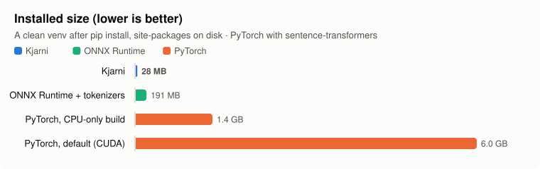
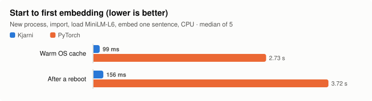
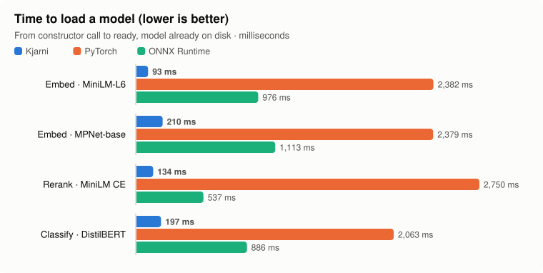
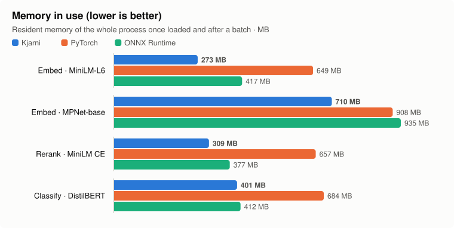
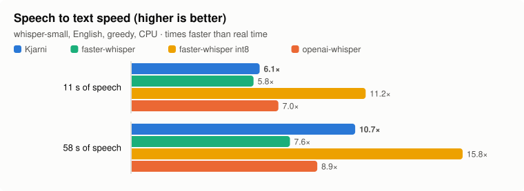
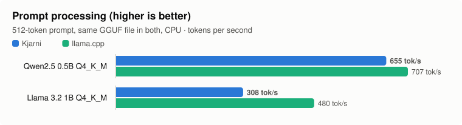
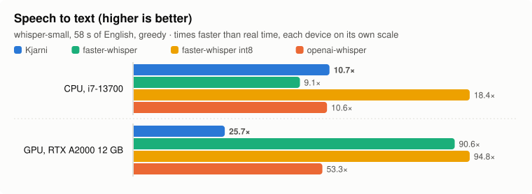
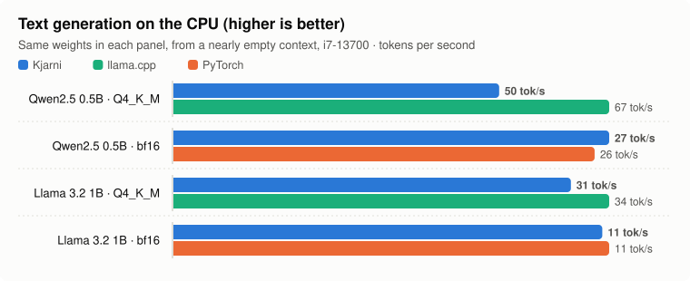
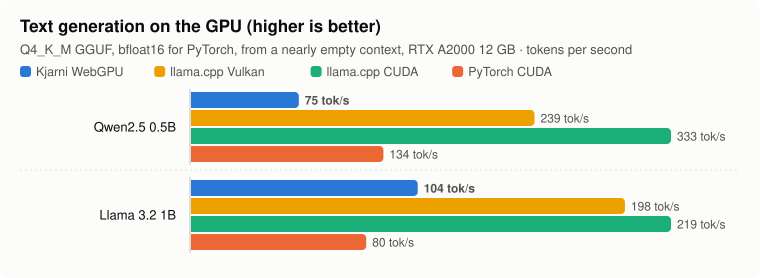
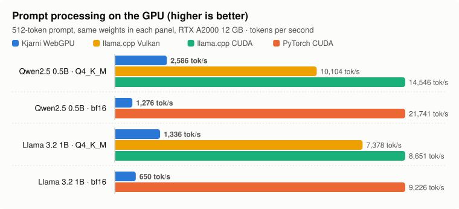

# Benchmarks

Kjarni against the usual ways of running the same models: PyTorch (through `transformers` and `sentence-transformers`), ONNX Runtime, faster-whisper and llama.cpp. Same weights, same inputs, same machine. The sections up to Text generation are CPU only; CPU and GPU covers both.

Reproduce with `bench/compare/run_encoders.py` and `bench/compare/run_rest.py`; `make_charts.py` and `make_report.py` turn the results into this page.

## Method

- **Machine:** Intel Core i7-13700 (8 performance and 8 efficiency cores, 24 threads), 64 GB, Linux. Idle: each run waits for a load average under 1 over the last minute and under 1.5 over the last five.
- **Isolation:** every engine runs in its own fresh process, so load time and memory are its own.
- **Memory:** *memory after* is what the process holds once the work is done; *peak* is the most it held at any point, usually while loading.
- **Timing:** minimum of repeated calls after warm-up, the least noisy estimate of what each engine can do. Medians are in the raw JSON.
- **Threads:** each engine's default. Kjarni uses rayon's pool; PyTorch and ONNX Runtime use the physical core count. For the LLMs, both engines get the better of 8 and 16 threads for each of prompt processing and generation.
- **Agreement:** encoder outputs are compared with PyTorch's; the largest difference is listed with each row. Generated text is recorded so the engines can be checked to have done the same work.
- **Versions:** torch 2.13.0+cpu, transformers 5.16.1, sentence-transformers 6.0.1, onnxruntime 1.31.0, faster-whisper 1.2.1, ctranslate2 4.8.4, open_clip 3.3.0, llama.cpp b11901.

## Install size and cold start

<picture>
  <source media="(prefers-color-scheme: dark)" srcset="charts/install-size-dark.svg">
  
</picture>

<picture>
  <source media="(prefers-color-scheme: dark)" srcset="charts/cold-start-dark.svg">
  
</picture>

Each stack installed with pip into its own new venv; size is its site-packages on disk, pip excluded. Reproduce with `bench/compare/run_footprint.py`.

| Stack | Installed | Packages | Install time | Versions |
|---|--:|--:|--:|---|
| **Kjarni** (CPU and GPU) | 28 MB | 1 | 1 s | kjarni 0.7.0 |
| PyTorch CPU-only build + sentence-transformers | 1.4 GB | 45 | 59 s | torch 2.15.0+cpu, sentence-transformers 6.3.0 |
| PyTorch default (CUDA) + sentence-transformers | 6.0 GB | 64 | 154 s | torch 2.15.0, sentence-transformers 6.3.0 |
| ONNX Runtime + tokenizers | 191 MB | 20 | 7 s | onnxruntime 1.32.0 |

Start to first embedding: a new Python process imports the library, loads all-MiniLM-L6-v2 and embeds one sentence on the CPU. *Cold* drops the model and the installed packages from the OS file cache first, as after a reboot. Median of 5.

| Engine | File cache | Whole process | Import | Load model | First vector |
|---|---|--:|--:|--:|--:|
| **Kjarni** | warm | 99 ms | 13 ms | 50 ms | 4 ms |
| **Kjarni** | cold | 156 ms | 25 ms | 88 ms | 6 ms |
| PyTorch + sentence-transformers | warm | 2,733 ms | 2,035 ms | 83 ms | 7 ms |
| PyTorch + sentence-transformers | cold | 3,720 ms | 2,720 ms | 112 ms | 46 ms |

## Embeddings, reranking and classification

<picture>
  <source media="(prefers-color-scheme: dark)" srcset="charts/encoders-throughput-dark.svg">
  
</picture>

<picture>
  <source media="(prefers-color-scheme: dark)" srcset="charts/encoders-load-dark.svg">
  
</picture>

<picture>
  <source media="(prefers-color-scheme: dark)" srcset="charts/encoders-memory-dark.svg">
  
</picture>

| Task | Engine | Batch of 64 | One text | Load | Memory after | Peak memory | Max diff vs PyTorch |
|---|---|--:|--:|--:|--:|--:|--:|
| Embed · all-MiniLM-L6-v2 | **Kjarni** | 194 ms (329/s) | 2.0 ms | 93 ms | 273 MB | 292 MB | 2e-07 |
| Embed · all-MiniLM-L6-v2 | PyTorch | 214 ms (299/s) | 3.3 ms | 2,382 ms | 648 MB | 730 MB | reference |
| Embed · all-MiniLM-L6-v2 | ONNX Runtime | 194 ms (329/s) | 1.4 ms | 976 ms | 418 MB | 416 MB | 2e-07 |
| Embed · all-mpnet-base-v2 | **Kjarni** | 1226 ms (52/s) | 18.7 ms | 210 ms | 710 MB | 750 MB | 2e-07 |
| Embed · all-mpnet-base-v2 | PyTorch | 1647 ms (39/s) | 30.0 ms | 2,379 ms | 908 MB | 1,161 MB | reference |
| Embed · all-mpnet-base-v2 | ONNX Runtime | 1189 ms (54/s) | 14.2 ms | 1,113 ms | 915 MB | 912 MB | 3e-07 |
| Rerank · ms-marco-MiniLM-L6 | **Kjarni** | 227 ms (282/s) | 8.4 ms | 134 ms | 310 MB | 324 MB | 4e-06 |
| Rerank · ms-marco-MiniLM-L6 | PyTorch | 268 ms (239/s) | 9.2 ms | 2,750 ms | 617 MB | 764 MB | reference |
| Rerank · ms-marco-MiniLM-L6 | ONNX Runtime | 242 ms (264/s) | 3.7 ms | 537 ms | 377 MB | 374 MB | 6e-06 |
| Classify · DistilBERT SST-2 | **Kjarni** | 151 ms (422/s) | 9.7 ms | 197 ms | 401 MB | 503 MB | 1e-07 |
| Classify · DistilBERT SST-2 | PyTorch | 209 ms (307/s) | 14.9 ms | 2,063 ms | 686 MB | 746 MB | reference |
| Classify · DistilBERT SST-2 | ONNX Runtime | 145 ms (443/s) | 12.3 ms | 886 ms | 412 MB | 439 MB | 1e-07 |

## Speech to text

<picture>
  <source media="(prefers-color-scheme: dark)" srcset="charts/whisper-dark.svg">
  
</picture>

whisper-small, English, greedy decoding, CPU.

| Audio | Engine | Time | Faster than real time | Load | Memory after | Peak memory |
|---|---|--:|--:|--:|--:|--:|
| 11 s | **Kjarni** | 1.80 s | 6.1× | 417 ms | 1,081 MB | 1,246 MB |
| 11 s | faster-whisper | 1.89 s | 5.8× | 1,424 ms | 1,677 MB | 2,121 MB |
| 11 s | faster-whisper-int8 | 0.98 s | 11.2× | 1,259 ms | 725 MB | 826 MB |
| 11 s | openai-whisper | 1.57 s | 7.0× | 2,013 ms | 1,388 MB | 1,665 MB |
| 58 s | **Kjarni** | 5.39 s | 10.7× | 441 ms | 1,105 MB | 1,444 MB |
| 58 s | faster-whisper | 7.61 s | 7.6× | 1,482 ms | 1,667 MB | 2,120 MB |
| 58 s | faster-whisper-int8 | 3.64 s | 15.8× | 1,335 ms | 728 MB | 830 MB |
| 58 s | openai-whisper | 6.49 s | 8.9× | 1,999 ms | 1,433 MB | 1,665 MB |

## Summarization and translation

distilbart-cnn-12-6 and flan-t5-base, each with its checkpoint's own generation settings.

| Task | Engine | Time | Load | Memory after | Peak memory | Output |
|---|---|--:|--:|--:|--:|---|
| summarize | **Kjarni** | 1,799 ms | 845 ms | 1,281 MB | 1,328 MB | The library will include a children's wing, a maker space with 3D printers, and a cafe … |
| summarize | PyTorch | 2,027 ms | 2,311 ms | 1,714 MB | 1,749 MB | The library will include a children's wing, a maker space with 3D printers, and a cafe … |
| translate | **Kjarni** | 711 ms | 514 ms | 1,052 MB | 1,249 MB | Das Haus ist klein, aber das Garten hinter es ist groß und voll von alten Bäumen. |
| translate | PyTorch | 695 ms | 2,294 ms | 1,401 MB | 1,409 MB | Das Haus ist klein, aber das Garten hinter es ist groß und voll von alten Bäumen. |

## Image search (CLIP)

ViT-B/32 with the LAION-2B weights, indexing 64 photos and running one text query.

| Engine | Images per second | Query | Load | Memory after | Peak memory |
|---|--:|--:|--:|--:|--:|
| **Kjarni** | 65.8 | 15.2 ms | 585 ms | 780 MB | 874 MB |
| open_clip | 57.7 | 15.8 ms | 3,448 ms | 1,177 MB | 1,679 MB |

## Text generation

<picture>
  <source media="(prefers-color-scheme: dark)" srcset="charts/decode-generation-dark.svg">
  
</picture>

<picture>
  <source media="(prefers-color-scheme: dark)" srcset="charts/decode-prompt-dark.svg">
  
</picture>

The same Q4_K_M GGUF file in both engines. llama.cpp is timed with its own `llama-bench` (pp512, tg128); Kjarni through its Python binding, from a 512-token prompt and 128 greedy tokens.

| Model | Engine | Prompt processing | Generation |
|---|---|--:|--:|
| qwen2.5-0.5b-instruct | **Kjarni** | 651 tok/s | 46.7 tok/s |
| qwen2.5-0.5b-instruct | llama.cpp | 690 tok/s | 65.8 tok/s |
| llama3.2-1b-instruct | **Kjarni** | 308 tok/s | 28.2 tok/s |
| llama3.2-1b-instruct | llama.cpp | 514 tok/s | 33.5 tok/s |

## CPU and GPU

Reproduce with `bench/compare/run_matrix.py`. CPU as above; GPU an NVIDIA RTX A2000 12 GB, with Kjarni on WebGPU (Vulkan here) and the others on CUDA, in fresh processes on a quiet machine.

<picture>
  <source media="(prefers-color-scheme: dark)" srcset="charts/matrix-embeddings-cpu-dark.svg">
  
</picture>

<picture>
  <source media="(prefers-color-scheme: dark)" srcset="charts/matrix-embeddings-gpu-dark.svg">
  
</picture>

<picture>
  <source media="(prefers-color-scheme: dark)" srcset="charts/matrix-whisper-dark.svg">
  
</picture>

<picture>
  <source media="(prefers-color-scheme: dark)" srcset="charts/matrix-generation-cpu-dark.svg">
  
</picture>

<picture>
  <source media="(prefers-color-scheme: dark)" srcset="charts/matrix-generation-gpu-dark.svg">
  
</picture>

<picture>
  <source media="(prefers-color-scheme: dark)" srcset="charts/matrix-prompt-gpu-dark.svg">
  
</picture>

| Model | Device | Engine | Batch of 64 | One text | Load | Max diff vs PyTorch on CPU |
|---|---|---|--:|--:|--:|--:|
| minilm | GPU | **Kjarni** | 554.9/s | 6.2 ms | 452 ms | 2e-07 |
| minilm | GPU | PyTorch | 1,767.1/s | 1.8 ms | 2,397 ms | 2e-07 |
| minilm | GPU | ONNX Runtime | 2,720.4/s | 1.2 ms | 625 ms | 1e-04 |
| bge-m3 | GPU | **Kjarni** | 31.1/s | 57.7 ms | 2,467 ms | 2e-06 |
| bge-m3 | GPU | PyTorch | 73.5/s | 10.5 ms | 8,153 ms | 1e-06 |
| bge-m3 | GPU | ONNX Runtime | 172.1/s | 7.5 ms | 1,302 ms | 4e-04 |
| minilm | CPU | **Kjarni** | 332.6/s | 2.1 ms | 101 ms |  |
| minilm | CPU | PyTorch | 301.9/s | 5.3 ms | 3,520 ms | reference |
| minilm | CPU | ONNX Runtime | 363.1/s | 1.4 ms | 677 ms | 2e-07 |
| bge-m3 | CPU | **Kjarni** | 15.7/s | 66.8 ms | 1,217 ms | 1e-06 |
| bge-m3 | CPU | PyTorch | 10.6/s | 61.0 ms | 7,233 ms | reference |
| bge-m3 | CPU | ONNX Runtime | 14.7/s | 48.5 ms | 1,390 ms | 4e-07 |

| Device | Engine | 58 s of speech | Faster than real time |
|---|---|--:|--:|
| GPU | **Kjarni** | 3.61 s | 15.9× |
| GPU | openai-whisper | 1.09 s | 52.6× |
| GPU | faster-whisper | 0.64 s | 89.3× |
| GPU | faster-whisper-int8 | 0.62 s | 92.7× |
| CPU | **Kjarni** | 5.39 s | 10.7× |
| CPU | openai-whisper | 6.49 s | 8.9× |
| CPU | faster-whisper | 7.62 s | 7.5× |
| CPU | faster-whisper-int8 | 3.65 s | 15.7× |

Generation is from the same Q4_K_M GGUF, except PyTorch and the rows marked safetensors. *After a prompt* follows 512 tokens; *short* starts from a nearly empty context, as llama-bench's tg128 does, so llama.cpp's one figure is in that column.

| Model | Device | Engine | Prompt | After a prompt | Short |
|---|---|---|--:|--:|--:|
| qwen2.5-0.5b-instruct | CPU | **Kjarni** | 661 | 47.6 | 51.0 |
| qwen2.5-0.5b-instruct | GPU | **Kjarni** | 1,564 | 58.5 | 74.9 |
| qwen2.5-0.5b-instruct | CPU | **Kjarni** safetensors | 644 | 26.2 | 26.2 |
| qwen2.5-0.5b-instruct | GPU | **Kjarni** safetensors | 1,431 | 57.9 | 74.2 |
| qwen2.5-0.5b-instruct | CPU | PyTorch | 707 | 12.2 | 11.5 |
| qwen2.5-0.5b-instruct | GPU | PyTorch | 21,948 | 131.6 | 133.6 |
| qwen2.5-0.5b-instruct | CPU | llama.cpp | 692 |  | 66.0 |
| qwen2.5-0.5b-instruct | GPU | llama.cpp CUDA | 14,532 |  | 333.4 |
| qwen2.5-0.5b-instruct | GPU | llama.cpp Vulkan | 10,159 |  | 238.6 |
| llama3.2-1b-instruct | CPU | **Kjarni** | 307 | 28.2 | 31.2 |
| llama3.2-1b-instruct | GPU | **Kjarni** | 725 | 78.7 | 103.6 |
| llama3.2-1b-instruct | CPU | **Kjarni** safetensors | 239 | 9.2 | 9.4 |
| llama3.2-1b-instruct | GPU | **Kjarni** safetensors | 653 | 52.0 | 60.0 |
| llama3.2-1b-instruct | CPU | PyTorch | 221 | 3.4 | 3.4 |
| llama3.2-1b-instruct | GPU | PyTorch | 9,328 | 78.9 | 80.0 |
| llama3.2-1b-instruct | CPU | llama.cpp | 483 |  | 33.5 |
| llama3.2-1b-instruct | GPU | llama.cpp CUDA | 8,612 |  | 219.3 |
| llama3.2-1b-instruct | GPU | llama.cpp Vulkan | 7,499 |  | 198.2 |

## Binding overhead

One MiniLM embedding of a short text, on the CPU, through each binding against the same library: the worst case for a binding, since the model does the least work. Median of 3,000 calls, best of three runs. Reproduce with `bench/bindings/run.py`.

| Language | Median per call | Against C |
|---|--:|--:|
| C | 3.44 ms | baseline |
| Rust | 3.43 ms | -11 µs |
| Python | 3.49 ms | +44 µs |
| Go | 3.37 ms | -76 µs |
| C# | 3.47 ms | +22 µs |

The differences are within run-to-run noise: Go and Rust come out ahead of C, which cannot be overhead.

