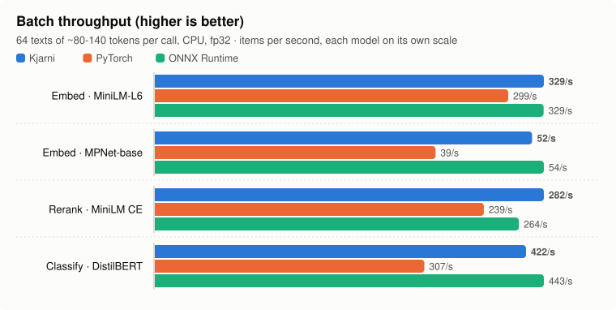
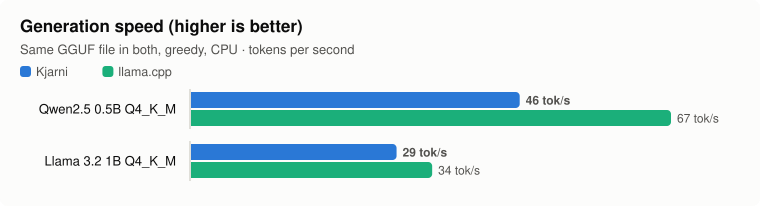
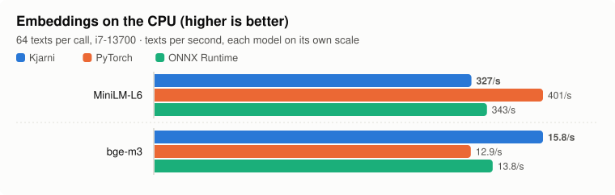
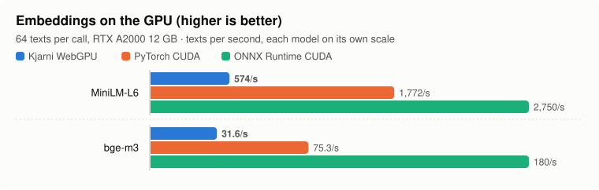

# Benchmarks

Kjarni against the usual ways of running the same models: PyTorch (through `transformers` and `sentence-transformers`), ONNX Runtime, faster-whisper and llama.cpp. Same weights, same inputs, same machine. The sections up to Text generation are CPU only; CPU and GPU covers both.

Reproduce with `bench/compare/run_encoders.py` and `bench/compare/run_rest.py`; `make_charts.py` and `make_report.py` turn the results into this page.

## Method

- **Machine:** Intel Core i7-13700 (8 performance and 8 efficiency cores, 24 threads), 64 GB, Linux. Idle: each run waits for a load average under 1 over the last minute and under 1.5 over the last five.
- **Isolation:** every engine runs in its own fresh process, so load time and memory are its own.
- **Memory:** *memory after* is what the process holds once the work is done; *peak* is the most it held at any point, usually while loading.
- **Timing:** minimum of repeated calls after warm-up, the least noisy estimate of what each engine can do. Medians are in the raw JSON.
- **Threads:** every engine on the CPU is run at its default thread count and at 8, one per performance core, and the faster run is reported. On this CPU PyTorch and CTranslate2 are fastest at 8; Kjarni is usually fastest at its default of 24, except on summarisation and translation. For the LLMs, each engine gets the better of 8 and 16 threads for each of prompt processing and generation.
- **Precision:** PyTorch runs the same safetensors as Kjarni, in bf16 and in f32, and the faster is reported. Quantised (Q4_K_M) models are compared only with llama.cpp, on the same GGUF file.
- **Scope:** one Linux machine. Windows, macOS and ARM have not been benchmarked to any extent, and other CPUs, particularly ones without separate performance and efficiency cores, may rank the engines differently.
- **Agreement:** encoder outputs are compared with PyTorch's; the largest difference is listed with each row. Generated text is recorded so the engines can be checked to have done the same work.
- **Versions:** torch 2.13.0+cpu, transformers 5.16.1, sentence-transformers 6.0.1, onnxruntime 1.31.0, faster-whisper 1.2.1, ctranslate2 4.8.4, open_clip 3.3.0, llama.cpp b11901.

## Install size and cold start

<picture>
  <source media="(prefers-color-scheme: dark)" srcset="charts/install-size-dark.svg">
  
</picture>

<picture>
  <source media="(prefers-color-scheme: dark)" srcset="charts/cold-start-dark.svg">
  
</picture>

Each stack installed with pip into its own new venv; size is its site-packages on disk, pip excluded. Reproduce with `bench/compare/run_footprint.py`.

| Stack | Installed | Packages | Install time | Versions |
|---|--:|--:|--:|---|
| **Kjarni** (CPU and GPU) | 28 MB | 1 | 1 s | kjarni 0.8.1 |
| PyTorch CPU-only build + sentence-transformers | 1.4 GB | 45 | 38 s | torch 2.15.0+cpu, sentence-transformers 6.3.0 |
| PyTorch default (CUDA) + sentence-transformers | 6.0 GB | 64 | 138 s | torch 2.15.0, sentence-transformers 6.3.0 |
| ONNX Runtime + tokenizers | 191 MB | 20 | 9 s | onnxruntime 1.32.0 |

Start to first embedding: a new Python process imports the library, loads all-MiniLM-L6-v2 and embeds one sentence on the CPU. *Cold* drops the model and the installed packages from the OS file cache first, as after a reboot. Median of 5.

| Engine | File cache | Whole process | Import | Load model | First vector |
|---|---|--:|--:|--:|--:|
| **Kjarni** | warm | 91 ms | 13 ms | 50 ms | 4 ms |
| **Kjarni** | cold | 152 ms | 26 ms | 89 ms | 7 ms |
| PyTorch + sentence-transformers | warm | 2,758 ms | 2,039 ms | 91 ms | 8 ms |
| PyTorch + sentence-transformers | cold | 3,718 ms | 2,708 ms | 122 ms | 47 ms |

## Embeddings, reranking and classification

<picture>
  <source media="(prefers-color-scheme: dark)" srcset="charts/encoders-throughput-dark.svg">
  
</picture>

<picture>
  <source media="(prefers-color-scheme: dark)" srcset="charts/encoders-load-dark.svg">
  
</picture>

<picture>
  <source media="(prefers-color-scheme: dark)" srcset="charts/encoders-memory-dark.svg">
  
</picture>

| Task | Engine | Batch of 64 | One text | Load | Memory after | Peak memory | Max diff vs PyTorch |
|---|---|--:|--:|--:|--:|--:|--:|
| Embed · all-MiniLM-L6-v2 | **Kjarni** | 194 ms (330/s) | 2.0 ms | 79 ms | 273 MB | 292 MB | 2e-07 |
| Embed · all-MiniLM-L6-v2 | PyTorch | 164 ms (389/s) | 3.1 ms | 2,393 ms | 649 MB | 731 MB | reference |
| Embed · all-MiniLM-L6-v2 | ONNX Runtime | 175 ms (365/s) | 1.4 ms | 478 ms | 417 MB | 415 MB | 2e-07 |
| Embed · all-mpnet-base-v2 | **Kjarni** | 1231 ms (52/s) | 18.7 ms | 206 ms | 710 MB | 750 MB | 2e-07 |
| Embed · all-mpnet-base-v2 | PyTorch | 1317 ms (49/s) | 14.9 ms | 2,371 ms | 908 MB | 1,162 MB | reference |
| Embed · all-mpnet-base-v2 | ONNX Runtime | 1189 ms (54/s) | 14.1 ms | 927 ms | 935 MB | 932 MB | 3e-07 |
| Rerank · ms-marco-MiniLM-L6 | **Kjarni** | 227 ms (282/s) | 8.5 ms | 103 ms | 309 MB | 323 MB | 4e-06 |
| Rerank · ms-marco-MiniLM-L6 | PyTorch | 210 ms (305/s) | 7.8 ms | 2,391 ms | 657 MB | 762 MB | reference |
| Rerank · ms-marco-MiniLM-L6 | ONNX Runtime | 214 ms (299/s) | 4.0 ms | 658 ms | 377 MB | 375 MB | 6e-06 |
| Classify · DistilBERT SST-2 | **Kjarni** | 144 ms (446/s) | 9.7 ms | 199 ms | 401 MB | 503 MB | 1e-07 |
| Classify · DistilBERT SST-2 | PyTorch | 143 ms (449/s) | 6.8 ms | 2,035 ms | 684 MB | 742 MB | reference |
| Classify · DistilBERT SST-2 | ONNX Runtime | 147 ms (435/s) | 7.3 ms | 782 ms | 412 MB | 439 MB | 1e-07 |

## Speech to text

<picture>
  <source media="(prefers-color-scheme: dark)" srcset="charts/whisper-dark.svg">
  
</picture>

whisper-small, English, greedy decoding, CPU.

| Audio | Engine | Time | Faster than real time | Load | Memory after | Peak memory |
|---|---|--:|--:|--:|--:|--:|
| 11 s | **Kjarni** | 1.79 s | 6.2× | 897 ms | 1,081 MB | 1,245 MB |
| 11 s | faster-whisper | 1.54 s | 7.1× | 1,387 ms | 1,681 MB | 2,120 MB |
| 11 s | faster-whisper-int8 | 0.88 s | 12.5× | 1,049 ms | 737 MB | 838 MB |
| 11 s | openai-whisper | 1.23 s | 9.0× | 2,031 ms | 1,396 MB | 1,665 MB |
| 58 s | **Kjarni** | 5.36 s | 10.7× | 422 ms | 1,105 MB | 1,443 MB |
| 58 s | faster-whisper | 6.34 s | 9.1× | 1,466 ms | 1,668 MB | 2,121 MB |
| 58 s | faster-whisper-int8 | 3.14 s | 18.3× | 1,191 ms | 741 MB | 842 MB |
| 58 s | openai-whisper | 5.42 s | 10.6× | 1,967 ms | 1,422 MB | 1,665 MB |

## Summarization and translation

distilbart-cnn-12-6 and flan-t5-base, each with its checkpoint's own generation settings.

| Task | Engine | Time | Load | Memory after | Peak memory | Output |
|---|---|--:|--:|--:|--:|---|
| summarize | **Kjarni** | 1,652 ms | 541 ms | 1,247 MB | 1,325 MB | The library will include a children's wing, a maker space with 3D printers, and a cafe … |
| summarize | PyTorch | 1,756 ms | 2,272 ms | 1,748 MB | 1,745 MB | The library will include a children's wing, a maker space with 3D printers, and a cafe … |
| translate | **Kjarni** | 625 ms | 549 ms | 1,051 MB | 1,250 MB | Das Haus ist klein, aber das Garten hinter es ist groß und voll von alten Bäumen. |
| translate | PyTorch | 585 ms | 2,278 ms | 1,403 MB | 1,409 MB | Das Haus ist klein, aber das Garten hinter es ist groß und voll von alten Bäumen. |

## Image search (CLIP)

ViT-B/32 with the LAION-2B weights, indexing 64 photos and running one text query.

| Engine | Images per second | Query | Load | Memory after | Peak memory |
|---|--:|--:|--:|--:|--:|
| **Kjarni** | 64.7 | 16.6 ms | 575 ms | 786 MB | 872 MB |
| open_clip | 70.1 | 12.1 ms | 3,193 ms | 1,183 MB | 1,681 MB |

## Text generation

<picture>
  <source media="(prefers-color-scheme: dark)" srcset="charts/decode-generation-dark.svg">
  
</picture>

<picture>
  <source media="(prefers-color-scheme: dark)" srcset="charts/decode-prompt-dark.svg">
  
</picture>

The same Q4_K_M GGUF file in both engines. llama.cpp is timed with its own `llama-bench` (pp512, tg128); Kjarni through its Python binding, from a 512-token prompt and 128 greedy tokens.

| Model | Engine | Prompt processing | Generation |
|---|---|--:|--:|
| qwen2.5-0.5b-instruct | **Kjarni** | 655 tok/s | 46.0 tok/s |
| qwen2.5-0.5b-instruct | llama.cpp | 707 tok/s | 67.2 tok/s |
| llama3.2-1b-instruct | **Kjarni** | 308 tok/s | 28.8 tok/s |
| llama3.2-1b-instruct | llama.cpp | 480 tok/s | 33.8 tok/s |

## CPU and GPU

Reproduce with `bench/compare/run_matrix.py`. CPU as above; GPU an NVIDIA RTX A2000 12 GB, with Kjarni on WebGPU (Vulkan here) and the others on CUDA, in fresh processes on a quiet machine.

<picture>
  <source media="(prefers-color-scheme: dark)" srcset="charts/matrix-embeddings-cpu-dark.svg">
  
</picture>

<picture>
  <source media="(prefers-color-scheme: dark)" srcset="charts/matrix-embeddings-gpu-dark.svg">
  
</picture>

<picture>
  <source media="(prefers-color-scheme: dark)" srcset="charts/matrix-whisper-dark.svg">
  
</picture>

<picture>
  <source media="(prefers-color-scheme: dark)" srcset="charts/matrix-generation-cpu-dark.svg">
  
</picture>

<picture>
  <source media="(prefers-color-scheme: dark)" srcset="charts/matrix-generation-gpu-dark.svg">
  
</picture>

<picture>
  <source media="(prefers-color-scheme: dark)" srcset="charts/matrix-prompt-gpu-dark.svg">
  
</picture>

| Model | Device | Engine | Batch of 64 | One text | Load | Max diff vs PyTorch on CPU |
|---|---|---|--:|--:|--:|--:|
| minilm | CPU | **Kjarni** | 326.8/s | 2.0 ms | 80 ms | 2e-07 |
| minilm | CPU | PyTorch | 400.6/s | 3.0 ms | 2,367 ms | reference |
| minilm | CPU | ONNX Runtime | 342.8/s | 1.2 ms | 626 ms | 2e-07 |
| bge-m3 | CPU | **Kjarni** | 15.8/s | 67.2 ms | 1,250 ms | 1e-06 |
| bge-m3 | CPU | PyTorch | 12.9/s | 52.6 ms | 6,819 ms | reference |
| bge-m3 | CPU | ONNX Runtime | 13.8/s | 46.8 ms | 1,296 ms | 5e-07 |
| minilm | GPU | **Kjarni** | 573.9/s | 5.5 ms | 487 ms | 2e-07 |
| minilm | GPU | PyTorch | 1,771.9/s | 1.8 ms | 2,331 ms | 2e-07 |
| minilm | GPU | ONNX Runtime | 2,750.0/s | 1.1 ms | 558 ms | 1e-04 |
| bge-m3 | GPU | **Kjarni** | 31.6/s | 52.0 ms | 2,776 ms | 2e-06 |
| bge-m3 | GPU | PyTorch | 75.3/s | 10.4 ms | 6,857 ms | 9e-07 |
| bge-m3 | GPU | ONNX Runtime | 180.4/s | 7.4 ms | 1,253 ms | 4e-04 |

| Device | Engine | 58 s of speech | Faster than real time |
|---|---|--:|--:|
| CPU | **Kjarni** | 5.38 s | 10.7× |
| CPU | openai-whisper | 5.45 s | 10.6× |
| CPU | faster-whisper | 6.33 s | 9.1× |
| CPU | faster-whisper-int8 | 3.13 s | 18.4× |
| GPU | **Kjarni** | 2.24 s | 25.7× |
| GPU | openai-whisper | 1.08 s | 53.3× |
| GPU | faster-whisper | 0.63 s | 90.6× |
| GPU | faster-whisper-int8 | 0.61 s | 94.8× |

Generation is from the same Q4_K_M GGUF, except PyTorch and the rows marked safetensors. *After a prompt* follows 512 tokens; *short* starts from a nearly empty context, as llama-bench's tg128 does, so llama.cpp's one figure is in that column.

| Model | Device | Engine | Prompt | After a prompt | Short |
|---|---|---|--:|--:|--:|
| qwen2.5-0.5b-instruct | CPU | **Kjarni** | 642 | 47.5 | 50.3 |
| qwen2.5-0.5b-instruct | CPU | **Kjarni** safetensors | 655 | 26.5 | 26.9 |
| qwen2.5-0.5b-instruct | CPU | PyTorch | 969 | 24.6 | 26.0 |
| qwen2.5-0.5b-instruct | CPU | llama.cpp | 704 |  | 67.2 |
| llama3.2-1b-instruct | CPU | **Kjarni** | 308 | 28.3 | 30.6 |
| llama3.2-1b-instruct | CPU | **Kjarni** safetensors | 264 | 10.9 | 11.1 |
| llama3.2-1b-instruct | CPU | PyTorch | 405 | 10.9 | 11.3 |
| llama3.2-1b-instruct | CPU | llama.cpp | 481 |  | 33.6 |
| qwen2.5-0.5b-instruct | GPU | **Kjarni** | 2,586 | 216.0 | 221.7 |
| qwen2.5-0.5b-instruct | GPU | **Kjarni** safetensors | 1,276 | 107.4 | 108.8 |
| qwen2.5-0.5b-instruct | GPU | PyTorch | 21,741 | 130.1 | 132.7 |
| qwen2.5-0.5b-instruct | GPU | llama.cpp CUDA | 14,546 |  | 331.9 |
| qwen2.5-0.5b-instruct | GPU | llama.cpp Vulkan | 10,104 |  | 236.4 |
| llama3.2-1b-instruct | GPU | **Kjarni** | 1,336 | 184.7 | 191.2 |
| llama3.2-1b-instruct | GPU | **Kjarni** safetensors | 650 | 71.6 | 71.6 |
| llama3.2-1b-instruct | GPU | PyTorch | 9,226 | 78.3 | 79.4 |
| llama3.2-1b-instruct | GPU | llama.cpp CUDA | 8,651 |  | 216.4 |
| llama3.2-1b-instruct | GPU | llama.cpp Vulkan | 7,378 |  | 193.5 |

## Binding overhead

One MiniLM embedding of a short text, on the CPU, through each binding against the same library: the worst case for a binding, since the model does the least work. Median of 3,000 calls, best of three runs. Reproduce with `bench/bindings/run.py`.

| Language | Median per call | Against C |
|---|--:|--:|
| C | 3.44 ms | baseline |
| Rust | 3.43 ms | -11 µs |
| Python | 3.49 ms | +44 µs |
| Go | 3.37 ms | -76 µs |
| C# | 3.47 ms | +22 µs |

The differences are within run-to-run noise: Go and Rust come out ahead of C, which cannot be overhead.

