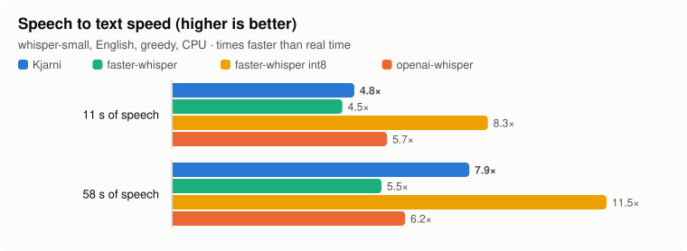
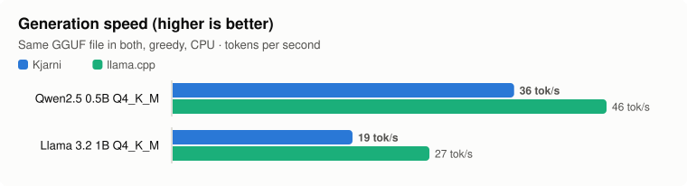
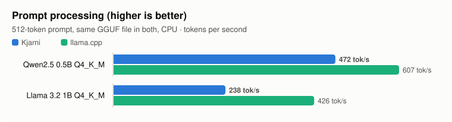
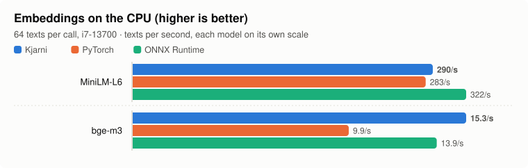
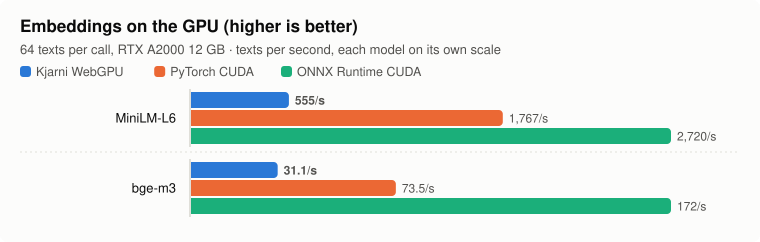
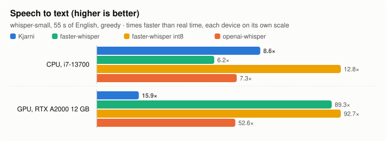
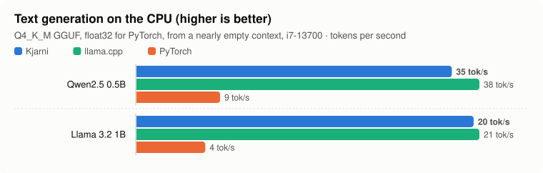
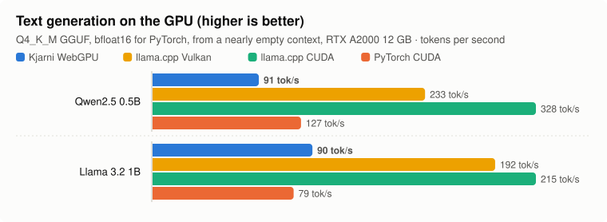
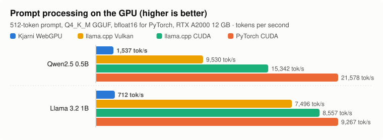

# Benchmarks

Kjarni against the usual ways of running the same models: PyTorch (through `transformers` and `sentence-transformers`), ONNX Runtime, faster-whisper and llama.cpp. Same weights, same inputs, same machine. The sections up to Text generation are CPU only; CPU and GPU covers both.

Reproduce with `bench/compare/run_encoders.py` and `bench/compare/run_rest.py`; `make_charts.py` and `make_report.py` turn the results into this page.

## Method

- **Machine:** Intel Core i7-13700 (8 performance and 8 efficiency cores, 24 threads), 64 GB, Linux. Idle: each run waits for a load average under 1 over the last minute and under 1.5 over the last five.
- **Isolation:** every engine runs in its own fresh process, so load time and memory are its own.
- **Memory:** *memory after* is what the process holds once the work is done; *peak* is the most it held at any point, usually while loading.
- **Timing:** minimum of repeated calls after warm-up, the least noisy estimate of what each engine can do. Medians are in the raw JSON.
- **Threads:** each engine's default. Kjarni uses rayon's pool; PyTorch and ONNX Runtime use the physical core count. For the LLMs, both engines get the better of 8 and 16 threads for each of prompt processing and generation.
- **Agreement:** encoder outputs are compared with PyTorch's; the largest difference is listed with each row. Generated text is recorded so the engines can be checked to have done the same work.
- **Versions:** torch 2.13.0+cpu, transformers 5.16.1, sentence-transformers 6.0.1, onnxruntime 1.31.0, faster-whisper 1.2.1, ctranslate2 4.8.4, open_clip 3.3.0, llama.cpp b11901.

## Embeddings, reranking and classification

<picture>
  <source media="(prefers-color-scheme: dark)" srcset="charts/encoders-throughput-dark.svg">
  
</picture>

<picture>
  <source media="(prefers-color-scheme: dark)" srcset="charts/encoders-load-dark.svg">
  
</picture>

<picture>
  <source media="(prefers-color-scheme: dark)" srcset="charts/encoders-memory-dark.svg">
  
</picture>

| Task | Engine | Batch of 64 | One text | Load | Memory after | Peak memory | Max diff vs PyTorch |
|---|---|--:|--:|--:|--:|--:|--:|
| Embed · all-MiniLM-L6-v2 | **Kjarni** | 205 ms (312/s) | 2.3 ms | 94 ms | 271 MB | 290 MB | 2e-07 |
| Embed · all-MiniLM-L6-v2 | PyTorch | 217 ms (295/s) | 3.5 ms | 2,434 ms | 649 MB | 738 MB | reference |
| Embed · all-MiniLM-L6-v2 | ONNX Runtime | 182 ms (351/s) | 1.5 ms | 674 ms | 412 MB | 409 MB | 2e-07 |
| Embed · all-mpnet-base-v2 | **Kjarni** | 1274 ms (50/s) | 24.2 ms | 229 ms | 708 MB | 749 MB | 2e-07 |
| Embed · all-mpnet-base-v2 | PyTorch | 1702 ms (38/s) | 29.5 ms | 2,449 ms | 1,036 MB | 1,178 MB | reference |
| Embed · all-mpnet-base-v2 | ONNX Runtime | 1087 ms (59/s) | 16.2 ms | 1,168 ms | 946 MB | 944 MB | 3e-07 |
| Rerank · ms-marco-MiniLM-L6 | **Kjarni** | 246 ms (261/s) | 9.1 ms | 113 ms | 308 MB | 323 MB | 4e-06 |
| Rerank · ms-marco-MiniLM-L6 | PyTorch | 273 ms (234/s) | 7.1 ms | 2,428 ms | 616 MB | 762 MB | reference |
| Rerank · ms-marco-MiniLM-L6 | ONNX Runtime | 247 ms (259/s) | 3.8 ms | 672 ms | 377 MB | 375 MB | 6e-06 |
| Classify · DistilBERT SST-2 | **Kjarni** | 157 ms (408/s) | 12.3 ms | 217 ms | 399 MB | 502 MB | 1e-07 |
| Classify · DistilBERT SST-2 | PyTorch | 223 ms (287/s) | 12.0 ms | 2,141 ms | 686 MB | 745 MB | reference |
| Classify · DistilBERT SST-2 | ONNX Runtime | 153 ms (418/s) | 8.9 ms | 872 ms | 412 MB | 439 MB | 1e-07 |

## Speech to text

<picture>
  <source media="(prefers-color-scheme: dark)" srcset="charts/whisper-dark.svg">
  
</picture>

whisper-small, English, greedy decoding, CPU.

| Audio | Engine | Time | Faster than real time | Load | Memory after | Peak memory |
|---|---|--:|--:|--:|--:|--:|
| 11 s | **Kjarni** | 2.29 s | 4.8× | 505 ms | 1,083 MB | 1,246 MB |
| 11 s | faster-whisper | 2.45 s | 4.5× | 1,605 ms | 1,676 MB | 2,120 MB |
| 11 s | faster-whisper-int8 | 1.32 s | 8.3× | 1,331 ms | 724 MB | 825 MB |
| 11 s | openai-whisper | 1.94 s | 5.7× | 2,209 ms | 1,353 MB | 1,665 MB |
| 58 s | **Kjarni** | 7.32 s | 7.9× | 502 ms | 1,105 MB | 1,428 MB |
| 58 s | faster-whisper | 10.40 s | 5.5× | 1,668 ms | 1,667 MB | 2,120 MB |
| 58 s | faster-whisper-int8 | 5.00 s | 11.5× | 1,127 ms | 728 MB | 829 MB |
| 58 s | openai-whisper | 9.34 s | 6.2× | 2,227 ms | 1,348 MB | 1,665 MB |

## Summarization and translation

distilbart-cnn-12-6 and flan-t5-base, each with its checkpoint's own generation settings.

| Task | Engine | Time | Load | Memory after | Peak memory | Output |
|---|---|--:|--:|--:|--:|---|
| summarize | **Kjarni** | 2,571 ms | 513 ms | 1,280 MB | 1,328 MB | The library will include a children's wing, a maker space with 3D printers, and a cafe … |
| summarize | PyTorch | 2,707 ms | 2,308 ms | 1,724 MB | 1,745 MB | The library will include a children's wing, a maker space with 3D printers, and a cafe … |
| translate | **Kjarni** | 989 ms | 531 ms | 1,048 MB | 1,246 MB | Das Haus ist klein, aber das Garten hinter es ist groß und voll von alten Bäumen. |
| translate | PyTorch | 947 ms | 2,321 ms | 1,410 MB | 1,407 MB | Das Haus ist klein, aber das Garten hinter es ist groß und voll von alten Bäumen. |

## Image search (CLIP)

ViT-B/32 with the LAION-2B weights, indexing 64 photos and running one text query.

| Engine | Images per second | Query | Load | Memory after | Peak memory |
|---|--:|--:|--:|--:|--:|
| **Kjarni** | 57.2 | 37.8 ms | 304 ms | 775 MB | 865 MB |
| open_clip | 52.2 | 16.9 ms | 3,460 ms | 1,176 MB | 1,679 MB |

## Text generation

<picture>
  <source media="(prefers-color-scheme: dark)" srcset="charts/decode-generation-dark.svg">
  
</picture>

<picture>
  <source media="(prefers-color-scheme: dark)" srcset="charts/decode-prompt-dark.svg">
  
</picture>

The same Q4_K_M GGUF file in both engines. llama.cpp is timed with its own `llama-bench` (pp512, tg128); Kjarni through its Python binding, from a 512-token prompt and 128 greedy tokens.

| Model | Engine | Prompt processing | Generation |
|---|---|--:|--:|
| qwen2.5-0.5b-instruct | **Kjarni** | 615 tok/s | 36.1 tok/s |
| qwen2.5-0.5b-instruct | llama.cpp | 611 tok/s | 45.9 tok/s |
| llama3.2-1b-instruct | **Kjarni** | 282 tok/s | 19.0 tok/s |
| llama3.2-1b-instruct | llama.cpp | 424 tok/s | 27.2 tok/s |

## CPU and GPU

Reproduce with `bench/compare/run_matrix.py`. CPU as above; GPU an NVIDIA RTX A2000 12 GB, with Kjarni on WebGPU (Vulkan here) and the others on CUDA, in fresh processes on a quiet machine.

<picture>
  <source media="(prefers-color-scheme: dark)" srcset="charts/matrix-embeddings-cpu-dark.svg">
  
</picture>

<picture>
  <source media="(prefers-color-scheme: dark)" srcset="charts/matrix-embeddings-gpu-dark.svg">
  
</picture>

<picture>
  <source media="(prefers-color-scheme: dark)" srcset="charts/matrix-whisper-dark.svg">
  
</picture>

<picture>
  <source media="(prefers-color-scheme: dark)" srcset="charts/matrix-generation-cpu-dark.svg">
  
</picture>

<picture>
  <source media="(prefers-color-scheme: dark)" srcset="charts/matrix-generation-gpu-dark.svg">
  
</picture>

<picture>
  <source media="(prefers-color-scheme: dark)" srcset="charts/matrix-prompt-gpu-dark.svg">
  
</picture>

| Model | Device | Engine | Batch of 64 | One text | Load | Max diff vs PyTorch on CPU |
|---|---|---|--:|--:|--:|--:|
| minilm | CPU | **Kjarni** | 289.6/s | 2.3 ms | 91 ms | 2e-07 |
| minilm | CPU | PyTorch | 282.7/s | 5.5 ms | 2,504 ms | reference |
| minilm | CPU | ONNX Runtime | 321.8/s | 1.4 ms | 495 ms | 2e-07 |
| minilm | GPU | **Kjarni** | 554.9/s | 6.2 ms | 452 ms | 2e-07 |
| minilm | GPU | PyTorch | 1,767.1/s | 1.8 ms | 2,397 ms | 2e-07 |
| minilm | GPU | ONNX Runtime | 2,720.4/s | 1.2 ms | 625 ms | 1e-04 |
| bge-m3 | CPU | **Kjarni** | 15.3/s | 83.6 ms | 1,295 ms | 1e-06 |
| bge-m3 | CPU | PyTorch | 9.9/s | 107.1 ms | 6,734 ms | reference |
| bge-m3 | CPU | ONNX Runtime | 13.9/s | 61.2 ms | 1,451 ms | 4e-07 |
| bge-m3 | GPU | **Kjarni** | 31.1/s | 57.7 ms | 2,467 ms | 2e-06 |
| bge-m3 | GPU | PyTorch | 73.5/s | 10.5 ms | 8,153 ms | 1e-06 |
| bge-m3 | GPU | ONNX Runtime | 172.1/s | 7.5 ms | 1,302 ms | 4e-04 |

| Device | Engine | 55 s of speech | Faster than real time |
|---|---|--:|--:|
| CPU | **Kjarni** | 6.71 s | 8.6× |
| CPU | openai-whisper | 7.84 s | 7.3× |
| CPU | faster-whisper | 9.34 s | 6.2× |
| CPU | faster-whisper-int8 | 4.49 s | 12.8× |
| GPU | **Kjarni** | 3.61 s | 15.9× |
| GPU | openai-whisper | 1.09 s | 52.6× |
| GPU | faster-whisper | 0.64 s | 89.3× |
| GPU | faster-whisper-int8 | 0.62 s | 92.7× |

Generation is from the same Q4_K_M GGUF, except PyTorch and the rows marked safetensors. *After a prompt* follows 512 tokens; *short* starts from a nearly empty context, as llama-bench's tg128 does, so llama.cpp's one figure is in that column.

| Model | Device | Engine | Prompt | After a prompt | Short |
|---|---|---|--:|--:|--:|
| qwen2.5-0.5b-instruct | CPU | **Kjarni** | 608 | 33.1 | 34.6 |
| qwen2.5-0.5b-instruct | GPU | **Kjarni** | 1,537 | 67.7 | 91.0 |
| qwen2.5-0.5b-instruct | CPU | **Kjarni** safetensors | 589 | 18.9 | 19.3 |
| qwen2.5-0.5b-instruct | GPU | **Kjarni** safetensors | 1,422 | 58.6 | 74.3 |
| qwen2.5-0.5b-instruct | CPU | PyTorch | 625 | 9.0 | 9.2 |
| qwen2.5-0.5b-instruct | GPU | PyTorch | 21,578 | 125.4 | 127.1 |
| qwen2.5-0.5b-instruct | CPU | llama.cpp | 665 |  | 37.7 |
| qwen2.5-0.5b-instruct | GPU | llama.cpp CUDA | 15,342 |  | 328.3 |
| qwen2.5-0.5b-instruct | GPU | llama.cpp Vulkan | 9,530 |  | 233.3 |
| llama3.2-1b-instruct | CPU | **Kjarni** | 296 | 19.1 | 20.4 |
| llama3.2-1b-instruct | GPU | **Kjarni** | 712 | 71.5 | 89.8 |
| llama3.2-1b-instruct | CPU | **Kjarni** safetensors | 283 | 8.3 | 8.4 |
| llama3.2-1b-instruct | GPU | **Kjarni** safetensors | 643 | 52.2 | 60.9 |
| llama3.2-1b-instruct | CPU | PyTorch | 242 | 4.1 | 4.2 |
| llama3.2-1b-instruct | GPU | PyTorch | 9,267 | 78.2 | 79.2 |
| llama3.2-1b-instruct | CPU | llama.cpp | 450 |  | 20.7 |
| llama3.2-1b-instruct | GPU | llama.cpp CUDA | 8,557 |  | 215.3 |
| llama3.2-1b-instruct | GPU | llama.cpp Vulkan | 7,496 |  | 192.4 |

## Binding overhead

One MiniLM embedding of a short text, on the CPU, through each binding against the same library: the worst case for a binding, since the model does the least work. Median of 3,000 calls, best of three runs. Reproduce with `bench/bindings/run.py`.

| Language | Median per call | Against C |
|---|--:|--:|
| C | 3.44 ms | baseline |
| Rust | 3.43 ms | -11 µs |
| Python | 3.49 ms | +44 µs |
| Go | 3.37 ms | -76 µs |
| C# | 3.47 ms | +22 µs |

The differences are within run-to-run noise: Go and Rust come out ahead of C, which cannot be overhead.

